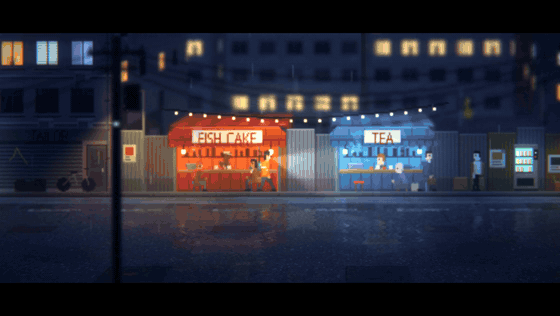

# SKYWAVE

<p align="center">
  <a href="https://github.com/rokrokss/thelastnight/releases/tag/trailer-v1"></a>
</p>
<p align="center">
  <b><a href="https://github.com/rokrokss/thelastnight/releases/download/trailer-v1/skywave-trailer.mp4">Watch the full trailer</a></b> (95 seconds, 1080p at 60 fps, with sound; a 76 MB download)
</p>

A cinematic pixel-art platformer for the browser. One foggy night in the port
city of Saltgate, a tower rigger climbs from the night market to the top of the
broadcast spire to wake a dead pirate station, because the storm warning was
only sent to people who paid for it.

SKYWAVE is an original game: its story, characters, world, art and music were
made for this project. Everything you see and hear is generated at runtime;
no image or audio files ship with it. (The clip above is a recording of it.)

## Play

```bash
npm install
npm run dev
```

Then open http://localhost:5173. A full run takes about 35 to 45 minutes and
has three endings.

| Action | Keyboard | Gamepad |
| --- | --- | --- |
| Move | Arrow keys or WASD | Stick or D-pad |
| Jump, confirm | Space or Z | A |
| Use, talk | E, X or Enter | X |
| Hide, brace against wind, take cover, drop through a platform | Down (drop: Down + Jump) | Down |
| Fire the rivet gun (on the quay) | F or J | Right trigger or B |
| Grab a ledge | Jump and hold toward it, then Up to pull over | same |
| Pause | Esc or P | Start |

Touch buttons appear on a touch screen. Progress saves at checkpoints; settings
(volume, text speed, screen shake, reduced flashes, graphics quality,
fullscreen) are in the pause menu and on the title screen.

## Scripts

| Command | What it does |
| --- | --- |
| `npm run dev` | Dev server with hot reload |
| `npm run build` | Type-check, then build a static site into `dist/` |
| `npm run preview` | Serve the built site locally |
| `npm run typecheck` | Type-check only |
| `npm test` | Unit tests and automated playthroughs |
| `npm run trailer` | Render the trailer to `trailer/out/skywave-trailer.mp4` (see below) |

`dist/` is plain static files with relative paths, so it can be hosted anywhere
or wrapped in a desktop shell.

## How it is built

The world is authored at 480x270 and drawn as pixel art, then lit and graded at
the display's resolution. That split is the look: crisp pixels under smooth
light.

```
src/
  core/      math, colour, input, save data, shared constants
  gfx/       Art (pixel drawing toolkit), Stage (per-frame 2D compositor),
             world (depth geometry), Renderer and shaders (WebGL2 pipeline)
  art/       procedural art: characters, buildings, props, skylines, one
             painter per scene in art/scenes/
  audio/     Web Audio synthesis: effects, ambience, generative score
  game/      simulation and story plumbing (World, Director, Session, View)
  content/   the chapters: level layout plus story script for each
  ui/        DOM overlay: captions, choices, menus, HUD, tuning scope
tests/       unit tests, route tests and full-story playthroughs
trailer/     the trailer: its cut, titles, score and offline renderer
tools/       trailer.mjs, which drives the render and encodes the video
media/       the clip at the top of this page
```

**Rendering.** Each frame the `Stage` draws four depth groups (far, mid, play,
foreground) into small canvases, each as a colour layer and a separate glow
layer. The `Renderer` uploads them and runs, in order: dynamic lights with
ray-marched shadows from an occluder mask, depth-of-field blur per group, the
world's depth geometry (see Depth, below), the main composite (far layers,
world, lit play layer, wet-floor reflections, light scattering so beams show
in fog, ground fog, foreground), bloom with an anamorphic streak, then a film
pass (tone curve, grade, aberration, vignette, grain, letterbox, fades).

**Depth.** The play layer is flat pixel art, and stays exactly as authored.
Everything behind and in front of it is real geometry in `gfx/world.ts`: the
ground is a plane that runs from just in front of the lens to the horizon;
every building, stall, container and roof has sides and a top as well as a
face; rows of whole buildings stand across the street; people, parked
scooters and street furniture stand at depths of their own. It is all drawn
through a perspective lens with a depth buffer, lit by the same lamps as the
play layer, fogged with distance, mirrored in the wet ground and thrown out
of focus by how far it is from the focal plane. Painters describe a scene's
depth with a small builder (`art/depth.ts`: `ground`, `block`, `backRow`,
`backCopy`, `nearProp`), and the textures are pixel art at the play layer's
scale, so a wall's side is the same brick as its face. Open water (the channel
behind the quay) is one more plane, lower than the deck: all of it mirrors, and
what it mirrors is the far side of the harbour, drawn out into streaks.

The lens can also shift: its vanishing point moves off the frame's centre
(`shiftX`, `shiftY` on a shot). The play plane does not move at all when it
does, so gameplay is untouched, but the world around it swings: tip the lens
down and the frame looks onto roofs, stall tarps and the road; slide it
sideways and the sides of buildings open up down the street.

**Camera.** `game/camera.ts` is a rig with a lens, not a scrolling window. A
shot is a small spec (`{ on: 'baek', zoom: 1.9, roll: 0.03, rack: -0.5 }`):
what to frame, how tight, how far off level, and where the focus sits. The
story cuts to shots, travels between them, or leans the gameplay camera toward
something for a moment (`cut`, `move`, `drift`, `glance`, `release` on the
`Director`). A push-in is a move through depth, not a crop: near layers grow
faster than far ones and the depth of field tightens with it. Rack focus pulls
the sharp plane to the foreground or out to the skyline. In play the same rig
frames by itself: it leads the direction of travel, opens up at a run, closes
in when Sol hides or talks, and tips and sways under pursuit or wind. The
director also has wipes, slow motion and mood offsets (`wipe`, `slowmo`,
`mood`).

**Art.** There are no sprite sheets. Characters are small jointed puppets
solved with two-bone IK and rasterised with aliased lines, so motion is
continuous. Scenes are painted by code from the same level data the simulation
collides against, so art and collision cannot drift apart.

**Simulation.** `World` knows nothing about rendering, audio or the DOM. That
is what makes the automated playthroughs possible.

**Fighting.** Two chapters on the quay are action sequences: a cover shooter
against Meridian's Enforcers, then a three-phase fight to free the Undertow,
the thing in the channel. Both live in the simulation (`game/combat.ts`: the
rivet gun, health, rounds against cover, Enforcers; `game/kaiju.ts`: the
creature's attacks, barbs and phases) and are only drawn by `art/combat.ts`
and `art/kaiju.ts`. Everything that draws the creature goes through one
function, `drawKaiju(stage, kaiju, time)`: its body is stood on the channel at
its real distance (a cut-out in the world's depth, behind the finger pier and
in front of the far bank, so the lens sees round it), white water spreads from
it across the same plane, and only its limbs come into the play layer. Every
attack is a warning first and a strike second; the tests hold it to that.

**Story.** Chapter scripts are plain async functions over a `Director`
(`say`, `walk`, `wait`, `tune`, `fade`...). Restarting from a checkpoint
disposes the director, which cancels whatever script was in flight.

## Trailer

```bash
npm run trailer              # 1920x1080, 60 fps
npm run trailer -- --draft   # 960x540, 30 fps: a quick look at the cut
npm run trailer -- --sheet   # contact sheets: a few frames from every take
npm run trailer -- --audio   # the soundtrack only
npm run trailer -- --crf=15  # a larger file, as an upload master
```

Output goes to `trailer/out/` (not tracked by git). It needs Google Chrome and
ffmpeg on the machine; nothing else is installed.

The finished film is attached to the
[`trailer-v1` release](https://github.com/rokrokss/thelastnight/releases/tag/trailer-v1).
GitHub does not play video files in a README, so the clip at the top of this
page is a silent cut of it: a few seconds from each part, as
`media/trailer-preview.gif`.

The trailer is shot in the game itself, not captured from a play session.
`trailer/film.ts` is the cut: a list of takes on a 96 bpm grid (one bar is 2.5
seconds), each of which dresses a chapter's world, places Sol and the cast,
and directs the camera with the same shot calls the story uses. Where Sol
runs and climbs she is driven by the autopilot from the route tests, so those
are the real physics. The page `trailer.html` steps the simulation at a fixed
60 Hz and draws each frame at full quality however long it takes;
`tools/trailer.mjs` opens that page in headless Chrome, receives the frames
over HTTP and pipes them into ffmpeg.

`trailer/previews.ts` holds more takes of the gunfight and the Undertow than
the cut uses (the game's own framing of each attack, the release), for looking
at: `npm run trailer -- --sheet --only=tide-loom,tide-sweep` renders a few
frames of any of them. `trailer/lab.ts` is the same for throwaway set-ups, and
`npm run trailer -- --cast` renders every character as a model sheet.

Sound is rendered offline to match: `trailer/score.ts` is a through-composed
piece built on the Radio Magpie call-sign, and every footstep, relay and drone
the pictures imply is replayed through the game's own sound engine at the
moment it happened. Titles are drawn over the picture from the game's pixel
font at whole-number scales.

## Tests

`npm test` runs ten suites:

- `core.test.ts`: movement physics (including frame-rate independence), ledges,
  ladders, wind, drone detection and cover, the tuning model, save data.
- `combat.test.ts`: the rivet gun and its pressure, rounds against cover (hit
  standing, safe crouched behind a barrier, not safe crouched in the open),
  aim assist, Enforcer tells and timing, shield units, health and recovery,
  the hung container.
- `kaiju.test.ts`: each of the Undertow's attacks (the warning, who it hits
  and who is sheltered), hooks that open only on a planted limb, and the
  phase logic from the first barb to going back under.
- `fights.test.ts`: the two fights with something at stake: going down sends
  Sol back to the last checkpoint with the wave or phase she was on, not the
  ones already won.
- `routes.test.ts`: a deliberately simple autopilot follows each chapter's
  critical path, proving every jump and climb is makeable.
- `story.test.ts`: plays the story from the prologue to each of the three
  endings as bare sessions (no UI), and checks that every trigger and
  interaction has a script.
- `game.test.ts`: runs the real `Game` under jsdom, with its real UI, menus,
  renderer and chapter loading (canvas and WebGL calls are no-ops there). It
  starts from the title menu, answers captions, choices and the tuning scope
  through the input layer, crosses every chapter hand-over to the credits, and
  checks saving and CONTINUE.

- `camera.test.ts`: the camera rig and the director's cinematic calls: cuts,
  timed moves, subjects that keep being followed, group framing, the level
  limits, a glance that never loses the player and lets go by itself, wipes,
  slow motion, moods.
- `trailer.test.ts`: the trailer's cut as data: every take on the grid, none
  overlapping, every chapter and speaker real.
- `puppet.test.ts`: the cast as data and as geometry: every look valid, the
  named archetypes all different in shape or dress, the crowd varied in build,
  age and wardrobe; every pose of every look drawn inside its sprite with its
  feet on the ground, as a silhouette and at other scales; a bare chest drawn
  as skin, and children dressed whatever the look asks for.

The playthrough suites share one script of actions (`tests/helpers/playthrough.ts`)
and differ only in what they drive. They run with stealth and wind switched
off and with nothing able to hurt Sol (the fights still have to be won: the
autopilot shoots every Enforcer and every barb); those have their own unit
tests.

## Third-party

- [Galmuri](https://github.com/quiple/galmuri) bitmap fonts by Lee Minseo,
  SIL Open Font License 1.1. The licence text is in
  `public/licenses/Galmuri-OFL.txt` and ships with the build.

Build tooling: Vite, TypeScript, Vitest (with jsdom for the full-game tests).

## Known limits

- Needs WebGL2. The game shows a plain message if it is missing.
- Audio is synthesised and was checked by measurement (levels, no errors), not
  by a mix engineer's ears. The same is true of the trailer's score.
- The trailer renderer is a development tool: it is not part of the build and
  has only been run on macOS.
- The name SKYWAVE has not been checked against existing trademarks.
